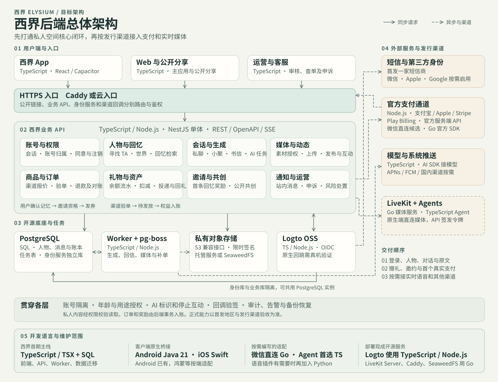

# 西界后端总体架构

## 现状与设计范围

当前前端的主要路径已覆盖账号切换、寻找 TA、人物与世界、对话与书信、记忆和动态、礼物与邀请、购买及订单。这一版足够冻结第一轮接口的用户路径。距离上线还有真实会话、跨设备恢复、账号注销、媒体授权与清除、正式 AI 生成、验单与退款、原生回跳等工作。

当前真实网络能力只有 Vite 下的 `/api/gifts`、`/api/invites`、`/api/relay` 预览中间件。登录与购买使用本机演示适配层。人物、对话和动态按本机身份分区，礼物和模拟订单也写在本机。首期按一个上线地区、一个优先发行渠道设计。现有 Android 包用于调试，发布构建及 App Store／Google Play 适配都需独立验收。付费商品、签约通道和模型服务待产品与资质验证后定。 [前端交互清单](./backend-interaction-inventory.md) · [应用入口](../frontend/src/main.tsx) · [账号数据](../frontend/src/App.tsx) · [登录演示](../frontend/src/auth/preview.ts) · [购买演示](../frontend/src/commerce/preview.ts) · [预览服务注册](../vite.config.ts) · [Android 构建配置](../mobile/android/app/build.gradle)

## 总体架构图

业务代码使用一个 TypeScript 代码库。业务 API 和后台 Worker 是两个运行角色，模块在同一业务进程内协作。登录使用独立的开源身份服务，业务数据与身份数据使用不同数据库或权限隔离的库。API 负责鉴权、提交和查询，Worker 负责长任务及需要重试的外部调用。首期用 PostgreSQL 承载业务与任务队列。支付、语音和推送按所选发行渠道逐项接入。

跨端共用 `/v1`、事件与业务数据库。账号、人物、会话、回忆、订单和账本的 ID、权限及状态规则由后端统一维护。Android、iOS、鸿蒙和 Web 各自适配登录回跳、安全存储、推送、支付唤起和系统权限。服务端用应用发行配置与渠道适配器接这些差异。新增端复用已有接口与数据结构，并按本端验证接入能力。 [客户端提示与接口共用规则](./backend-api-contract.md#21-请求结果与分页)

## 开发语言与运行环境

首期西界业务主栈用 **TypeScript + SQL**。同一套 TypeScript 覆盖 Web、App 界面、业务 API、后台任务和渠道对接。Android 原生层沿用项目里的 Java 21。后续原生 SDK 和额外语言按所选渠道验证后再加入。

| 环节 | 西界维护的语言与框架 | 当前状态及边界 |
| --- | --- | --- |
| Web、App 界面与运营界面 | **TypeScript／TSX**，React。样式用 CSS 和现有 Tailwind，Vite 构建 | App 与 Web 复用现有页面。运营界面沿用同一语言。 [前端依赖](../package.json) |
| Android 原生桥接 | **Java 21**，Capacitor 宿主与原生插件 | 已有 `MainActivity` 和系统窗口插件。新增工作集中在授权与支付回跳、推送、麦克风与相机权限等 SDK 连接。优先复用现成插件。 [Android 构建配置](../mobile/android/app/build.gradle) · [原生入口](../mobile/android/app/src/main/java/app/elysium/figma/dev/MainActivity.java) |
| iOS 原生桥接 | **Swift**，按需接 Capacitor 插件、系统授权、StoreKit 和推送 | 为后续 iOS 发布的选型。当前项目包含 Android 宿主。 [Capacitor iOS 插件指南](https://capacitorjs.com/docs/plugins/ios) |
| 登录和账号 | **TypeScript／Node.js** 写西界的账号映射、会话鉴权、绑定与切号联调 | 优先部署 **Logto OSS** 现成的 TypeScript／Node.js 身份服务，复用 SDK 和协议。第三方原生授权按平台走 Java／Swift 桥。 [Logto 源码](https://github.com/logto-io/logto) · [Capacitor 接入](https://docs.logto.io/quick-starts/capacitor-js) |
| 业务 API、聊天、邀请与资产 | **TypeScript／Node.js**，NestJS，OpenAPI 描述接口 | 人物、会话、回忆、动态、礼物、邀请、订单和运营模块在同一后端代码库。 [NestJS 文档](https://docs.nestjs.com/) |
| 数据、检索与迁移 | **SQL**，PostgreSQL | SQL 用于表结构、迁移、约束、事务和账号内检索。Node 业务代码通过数据库客户端读写。 |
| 后台任务与 AI 文本 | **TypeScript／Node.js**，pg-boss 与 AI SDK Core | 同一代码库的独立 Worker 处理生成、回信、媒体调度、补单与推送。首期由 Node Worker 调用获准的模型服务。 [pg-boss](https://github.com/timgit/pg-boss) · [AI SDK](https://github.com/vercel/ai) |
| 支付订单、验单与退款 | **TypeScript／Node.js** 作为主语言。优先用支付宝、Apple、Stripe 的 Node SDK，Google Play 走官方服务端 API | 微信支付优先评估合适的收单接入。若确定直连且需要独立适配，使用 **Go** 官方库写薄适配，限定在渠道签名、请求和回调校验，订单及权益仍由 TypeScript 业务模块处理。 [支付宝 Node SDK](https://github.com/alipay/alipay-sdk-nodejs-all) · [Apple Node SDK](https://github.com/apple/app-store-server-library-node) · [Stripe Node SDK](https://github.com/stripe/stripe-node) · [Play 服务端 API](https://developer.android.com/google/play/billing/backend) · [微信支付 Go SDK](https://github.com/wechatpay-apiv3/wechatpay-go) |
| 实时语音与视频 | 启用时优先用 **TypeScript／Node.js** 写语音 Agent，部署 **Go** 实现的 LiveKit Server | 先验证选定地区的转写、模型、合成插件和原生媒体桥。若关键插件或本地模型只适合 Python，再给独立 Agent 增加 **Python**。 [LiveKit Server](https://github.com/livekit/livekit) · [LiveKit Agents Node.js](https://github.com/livekit/agents-js) · [Python 与 Node.js 快速入门](https://docs.livekit.io/agents/start/voice-ai/) |
| 网关、对象存储与部署 | 网关和存储采用现成服务，部署使用 **YAML**、Caddyfile 等配置 | Caddy 和自托管候选 SeaweedFS 使用 Go 实现，按组件部署与维护。私有存储也可接同区托管。 [Caddy](https://github.com/caddyserver/caddy) · [SeaweedFS](https://github.com/seaweedfs/seaweedfs) |

部署现成组件主要维护配置、升级和运行。当前 Android 构建与验包还使用 PowerShell 和 Python 脚本，归在开发工具链。 [构建脚本](../mobile/build-debug.ps1) · [验包脚本](../mobile/verify-apk.py)

## 开源复用与外部接入

| 能力 | 建议选型与使用时机 | 西界负责的边界 |
| --- | --- | --- |
| API 与入口 | Caddy 或云入口处理 HTTPS。NestJS（MIT）做模块化 API，生成 OpenAPI 契约，沿用现有前端的 TypeScript 工具链。 [Caddy HTTPS](https://caddyserver.com/docs/automatic-https) · [NestJS 源码与许可证](https://github.com/nestjs/nest) · [OpenAPI 文档](https://docs.nestjs.com/openapi/introduction) | 统一对象授权、错误与重试语义、分页及版本兼容。入口或 API 对公开链接和发码请求分别限流 |
| 身份与会话 | **优先验证 Logto OSS（MPL-2.0）**。有 Capacitor SDK、短信连接器和微信 Native 接入说明，可配置 Apple／Google 等渠道。首期先接一个真实短信通道。Logto 同一租户仅启用一个短信连接器，多地区短信路由随发行计划评估。正式认证采用提供方支持的流程，现有西界登录入口、切换、取消返回和成功过渡可保留。Logto OSS 的完整自定义登录页有定制成本，官方 Bring your UI 受版本与许可证条件约束。若必须保留逐屏自定义表单，验证 Better Auth（MIT）与原生回跳作为备选，只选一套认证核心。 [Logto OSS](https://docs.logto.io/logto-oss) · [Logto 源码](https://github.com/logto-io/logto) · [Capacitor SDK](https://docs.logto.io/quick-starts/capacitor-js) · [短信连接器](https://docs.logto.io/connectors/sms-connectors) · [微信 Native](https://docs.logto.io/integrations/wechat-native) · [Better Auth](https://github.com/better-auth/better-auth) | 用可信的 `issuer + subject` 映射西界账号 UUID，显式验证绑定。切号期间保留原会话，验证新身份后再替换。微信原生回跳与 Capacitor 的组合需要真机先验，短信仍通过实际运营商／服务商投递 |
| 数据与任务 | PostgreSQL 和 pg-boss（MIT）。业务记录与需要可靠触发的任务同事务提交，依靠任务重试和业务幂等。首期检索在账号范围内做结构化过滤及文本匹配，中英样本达标后再启用所需索引。 [PostgreSQL 许可证](https://www.postgresql.org/about/licence/) · [pg-boss 事务入队](https://github.com/timgit/pg-boss) · [pg_trgm](https://www.postgresql.org/docs/current/pgtrgm.html) | 设计唯一键、事务和失效策略。模型、支付或推送的外部副作用要独立去重和补偿 |
| 图片、音频和视频 | 以 S3 兼容 API 隔离对象存储。SeaweedFS（Apache-2.0）用于需要自托管的场景。正式环境优先比较同区托管对象存储的总运维成本，验证签名、分片、CORS 和删除后再选。 [SeaweedFS](https://github.com/seaweedfs/seaweedfs) · [S3 签名 URL](https://docs.aws.amazon.com/AmazonS3/latest/userguide/using-presigned-url.html) | 素材入库、权属、访问与撤权、上传验证、格式检查及处理结果。数据库存媒体身份和权限，存储桶设为私有 |
| AI 对话、书信与生成 | 采用开源 AI SDK Core，显式配置获准的区域模型提供方。REST 写入和查询，前台用 SSE 反馈，断线后按游标补读。对话、人物回忆、延时来信共用一个业务事实来源。 [AI SDK 源码](https://github.com/vercel/ai) · [生成与流式接口](https://ai-sdk.dev/docs/ai-sdk-core/generating-text) | 人物授权上下文、用户原文与 AI 生成的区分、消息状态、来源追踪、成本配额、任务取消与恢复。模型请求只带当前授权所需资料 |
| 实时通话 | 有真实语音通话的交付需求时接 LiveKit Server＋Agents（Apache-2.0）。优先 Node.js Agent，复用 LiveKit SDK 与 WebRTC/TURN，后端签发单房间短时访问令牌。文本消息、同世界小聚和书信先复用前述会话模块。视频数字人另验证媒体生成与素材授权。 [LiveKit Server](https://github.com/livekit/livekit) · [LiveKit Agents](https://github.com/livekit/agents) · [部署与 TURN](https://docs.livekit.io/transport/self-hosting/deployment/) | 通话权限、模型会话、停止生成、留存与摘要。RTC 负责实时媒体传输。真人跨账号聊天属于待定能力，确认后再评估现成 IM |
| 站内消息与推送 | 收件箱用同一业务数据库。按需要连接 APNs、FCM 或所选国内 Android 渠道支持的系统推送，端侧权限和系统展示交给原生 SDK。 [APNs](https://developer.apple.com/documentation/usernotifications/sending-notification-requests-to-apns) · [FCM](https://firebase.google.com/docs/cloud-messaging) | 可读通知、已读、推送设备管理和去重。推送仅携带必要事件标识，打开后走鉴权查询 |
| 运维和观测 | 优先 Docker Compose 部署 API、Worker 和身份服务，数据库、备份及对象存储可托管。用 OpenTelemetry 接已有日志、指标和追踪工具。部署规格随实测并发、恢复目标与预算调整。 [OpenTelemetry](https://opentelemetry.io/docs/what-is-opentelemetry/) · [PostgreSQL 归档与恢复](https://www.postgresql.org/docs/current/continuous-archiving.html) | 告警覆盖支付差异、任务积压、模型错误和备份恢复。日志保留请求关联号、事件号和结果，避开私聊原文及凭据。服务密钥分环境，外部回调独立鉴权 |

开源组件接入细化到 SDK 方法、平台接口、版本核对和验收条件。当前后端组件均处于选型或待接入阶段。 [开源项目接入与验收](./backend-api-contract.md#421-开源项目接口和西界的实现边界)

### 支付按发行渠道接入

第一款正式付费商品与发行渠道先定。Capacitor 原生内购桥可验证 MIT 许可的社区插件及商店 SDK 兼容性。微信原生桥也先用现成插件验证，并核对与 Logto 的授权回跳。每个渠道用官方 SDK、服务端 API 或有资质的服务商，西界保留同一套订单与权益接口。试用邮资、邀请券和付费权益在流水中可区分。跨平台权益的可用范围随渠道条款和商品类型确认。 [Capacitor 内购插件](https://github.com/j3k0/cordova-plugin-purchase/blob/master/capacitor/README.md) · [微信 Capacitor 桥](https://github.com/Cap-go/capacitor-wechat)

| 发行渠道 | 接入方案 | 生产前验证 |
| --- | --- | --- |
| iOS App Store 数字商品 | StoreKit 与 App Store Server API/Notifications。服务端优先用 Apple 官方 Node 库。按地区和资格核对外部购买或替代结算条款。 [Apple 审核指南](https://developer.apple.com/app-store/review/guidelines/) · [Apple 服务端库](https://github.com/apple/app-store-server-library-node) | 沙箱下单、验签、关联西界账号、重复通知、退款及可恢复商品 |
| Google Play 数字商品 | Play Billing + Android Publisher API + 实时开发者通知。按国家与资格核对替代结算。 [Play 付款政策](https://support.google.com/googleplay/android-developer/answer/9858738?hl=en) · [Play 服务端集成](https://developer.android.com/google/play/billing/backend) | 待付款、验证购买令牌、入账后按商品确认或消耗、退款与重装恢复 |
| 中国大陆合适的 Android 渠道与独立网页 | 微信支付和支付宝按场景与商户资质选择。支付宝有官方 Node SDK。微信支付优先官方支持的服务端 SDK，若首期 Node 主服务缺少适用官方库，先评估有资质的统一收单服务，需要独立适配时，用官方 Go SDK 做薄适配。 [微信支付产品](https://pay.wechatpay.cn/doc/v3/merchant/4012068590) · [微信支付官方 Go 库](https://github.com/wechatpay-apiv3/wechatpay-go) · [支付宝 Node SDK](https://github.com/alipay/alipay-sdk-nodejs-all) | 对应渠道允许销售该类商品，商户／应用资质、唤起与回跳、验签和主动查单 |
| 海外独立网页 | 商户地区和业务通过审核时可采用 Stripe Checkout 托管收银台，卡及钱包按可用性展示。 [Stripe Checkout](https://docs.stripe.com/payments/checkout/how-checkout-works) | 商户主体、地区与币种、异步结果及退款。按平台规则决定网页销售及 App 内访问方式 |

## 前端对接的业务边界

下面是架构层的资源组。具体路由、字段、服务调用和实现顺序见接口规范草案。主题、字体、页面返回、机位、动效和固定版本推荐可留端侧。 [后端接口与实现规范](./backend-api-contract.md) · [数据库结构草案](./backend-api-contract.md#53-postgresql-数据结构草案)

| 页面与触发 | 建议接口资源组 | 后端结果与验收 |
| --- | --- | --- |
| 登录、切号、我页、协议及注销（A） | `sessions`、`accounts/me`、`identities`、`consents`、`deletion-requests`，认证流程走身份服务 | 正常、取消、拒绝和需重新验证均有可区分结果。切到 B 时人物、聊天、搜索、资产及媒体均隔离。原生与 Web 单独注册 OAuth 客户端，使用受支持的 Authorization Code + PKCE。支持注册的 App Store 版需提供应用内注销发起，Google Play 版还需提供网页入口。 [Apple 注销要求](https://developer.apple.com/support/offering-account-deletion-in-your-app/) · [Google Play 注销要求](https://support.google.com/googleplay/android-developer/answer/13327111) |
| 寻找 TA、人物资料、迁居、素材与纪念日（B） | `person-drafts`、`persons`、`worlds`、`media`、`reminders` | 上传与提取状态可恢复，确认只创建一个人物。素材、生成候选、用户确认原文分开。迁居保留人物身份和历史消息，旧礼物按历史快照读回 |
| 相见列表、私聊、小聚、书信、通话（C） | `conversations`、`messages`、`letters`、`generation-jobs`、`events`，二期 `call-sessions` | 发送有客户端操作 ID，消息与任务同事务。SSE 进度可丢后补读，最终消息以已存记录为准。延时回信在离开 App 后仍能处理 |
| 珍藏、星图、世界与动态（D） | `memories`、`search`、`feed`、`posts`、`reactions`、`comments` | 搜索结果可定位真实人物、消息或回忆 ID。已确认原文和回响关联但可独立恢复。原文与媒体撤权后同步收回可查询范围 |
| 礼物、会话卡片、陈列、资产及收件箱（E） | `gift-catalog`、`gift-deliveries`、`wallet`、`ledger`、`notifications` | 余额扣减与寄件回执同事务，重复提交返回原结果。回礼、陈列和消息卡片引用同一投递对象，系统消息依据真实事件 |
| 邀请、共创、公开链接（F） | `referrals`、`shared-goals`、`contributions`、`public-links`，保留接力时才接 `relays` | 首次真实注册与首次合格记忆驱动发券。并发争最后一席只保留一次成功贡献。匿名访客只能读公开投影及获准贡献，链接支持撤回与过期 |
| 商品、报价、下单、支付结果、订单与售后（G） | `products`、`quotes`、`orders`、`payment-attempts`、`refunds`、渠道回调 | 报价按渠道与地区返回。回到 App 查原订单。界面分别展示待支付、待确认、已支付待发放、已到账、关闭与退款状态。订单和权益跨设备可查 |

## 四条不能断开的链路

1. **账号与资料归属**　客户端只提供登录凭证或已验证的会话。服务端建立稳定 `accountId`，私人实体及媒体引用带账户归属。数据库行级策略作为第二层，运行角色使用最小权限。使用事务内租户上下文，测试连接复用、后台任务和误传他人 ID。客户端缓存随账号切换隔离。 [PostgreSQL 行级权限](https://www.postgresql.org/docs/current/ddl-rowsecurity.html)
2. **对话到回忆**　用户消息和生成任务一次提交 → Worker 按授权加载人物与最少上下文 → 存正式 AI 回复与来源 → 用户确认才形成回忆原文 → 星图、世界与对话读取同一记忆身份。删除或撤权时先阻止读取与在途写回，再异步清理索引和媒体。已签发的媒体 URL 可能在到期前仍可访问。需要即时撤回的素材走授权代理或可即时失效的访问方式。 [签名 URL 的有效期](https://docs.aws.amazon.com/AmazonS3/latest/userguide/using-presigned-url.html)
3. **付款到权益**　订单记录本次报价 → 收银台提交或系统回跳 → 服务端验签、查单并核对渠道、环境、交易号、商品与账号 → 在数据库唯一约束下同时确认交易并入队发放任务 → Worker 同事务记录权益流水、发放结果和通知任务。即使用户在付款期间切了号，权益仍只给原订单归属账号。退款以独立逆向流水处理。客户端收到回跳只查询，重复回调或跨设备恢复不会重复发放。对“退款时邮资已消费”等情形先定业务规则。 [PostgreSQL 约束](https://www.postgresql.org/docs/current/ddl-constraints.html)
4. **邀请到奖励**　已验证注册事件绑定唯一归因 → 当前账号确认首条合格回忆 → 服务端事务记录双方奖励与站内通知 → 账本和会话读取同一事件。导入旧资料、样例内容和重试默认不计入首次有效记忆，具体活动规则由产品定稿。公开共创采用最小可见投影，私有原文须由发起人确认采纳后保存。

### 共用契约与迁移

- 私有查询由服务端会话确定 `accountId`。公共链接使用独立的不透明凭据和受限投影。媒体短签名只针对已授权的对象与操作。模型、Webhook 与后台管理分别用专用凭据。
- 写操作携带幂等键并可查询原结果。同键同参返回原结果，异参冲突。消息顺序用可恢复游标，时间统一传带时区语义的时间戳，金额用货币最小单位整数加币种。退款、已支付与权益状态分别存，错误映射到可读的操作状态。
- 旧本机数据保留到完成明确归属与回读。真实账号验证后由用户确认导入，建立旧 ID 到正式 ID 的映射，先核对人物、原文和媒体数量。当前试用资产、模拟订单及浏览器访客奖励进入隔离的预览范围。导入和恢复采用相同去重键，失败后可重试。
- 部署前明确目标地区、资料的存储和推理处理位置、模型与语音授权、备份保留和删除流程。媒体处理、日志与对账各有独立权限。按实际地区与发行渠道确认规则，先测试恢复再承诺可用性目标。

### 中国大陆公开发布的前置验证

若西界向境内公众提供持续的拟人化情感互动，需按产品形态核对已施行的《人工智能拟人化互动服务管理暂行办法》。若适用，虚拟亲属等虚拟亲密关系不得向未成年人提供，公开上线需按规定开展安全评估。架构应支持年龄与适用范围判断、协议与用途授权、AI 标识和时长提示、停止互动、风险响应、投诉以及交互数据复制和删除。生成前和写回前复核授权，AI 工具权限与订单、扣邮资和发券隔离。若上线仿声或人脸合成，另验素材许可、身份和标识。 [拟人化互动服务暂行办法](https://www.cac.gov.cn/2026-04/10/c_1777558395078289.htm) · [深度合成管理规定](https://www.cac.gov.cn/2022-12/11/c_1672221949354811.htm) · [生成合成内容标识办法](https://www.cac.gov.cn/2025-03/14/c_1743654684782215.htm)

## 实施顺序与验收

以下为架构阶段。具体功能的优先级、依赖和验收门槛见交付方案。 [功能优先级与交付顺序](./backend-delivery-priorities.md)

| 阶段 | 交付切片 | 可观察验收 |
| --- | --- | --- |
| 0 选型验证 | 一条真实短信或主登录链路、一个首发客户端、一个签名上传、一个测试商品渠道。真机验证认证取消与回跳。要首发微信或内购就先验证对应 SDK | 成功与失败可以回到原入口，手机号和 OAuth 映射稳定。不同账号不能读取彼此对象。沙箱付款可查回同一订单 |
| 1 核心私域闭环 | 先用 PostgreSQL 与同库队列交付认证、人物、私有素材、文字会话、确认回忆及星图定位。书信、私人动态与复访体验在主链验收后接入 | 从寻找 TA 到聊天、珍藏、换设备读回原文。任务中断能恢复。删除人物或撤权后的读取、索引及任务均按规则失效 |
| 2 资产与首个真实交易渠道 | 先交付礼物流水与试用赠礼。邀请奖励、单渠道交易和公开共创按各自依赖推进。其余渠道复用同一边界按需接入 | 同订单重复通知、断网重试或跨设备恢复只发一次权益。两人争最后席位只成功一次。退款和余额有可核对记录 |
| 3 按需扩展 | 其他市场支付、系统推送、实时语音、视频数字人及独立搜索索引。真人 IM 由产品是否开放跨账号交流决定 | 真实网络和真机条件下验证进入、重连、退出、权限撤回及数据隔离。依实际延迟、质量和运维成本决定是否扩大部署 |

本次为目标架构设计和源码核对。组件选型基于官方文档与许可证。商户资质、各地区审核结果、真实设备回跳、容量与成本尚需按首发范围验证。
